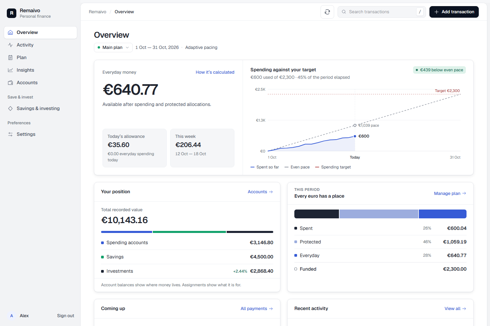
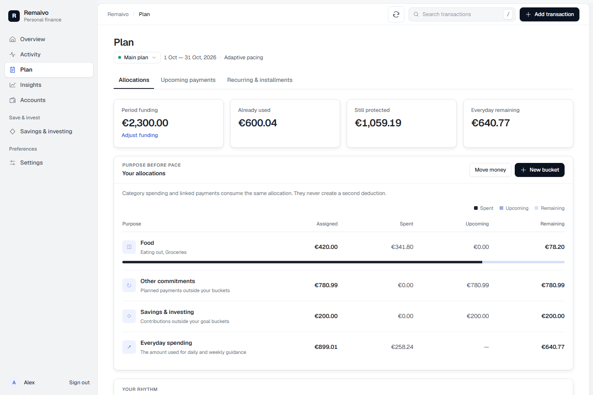
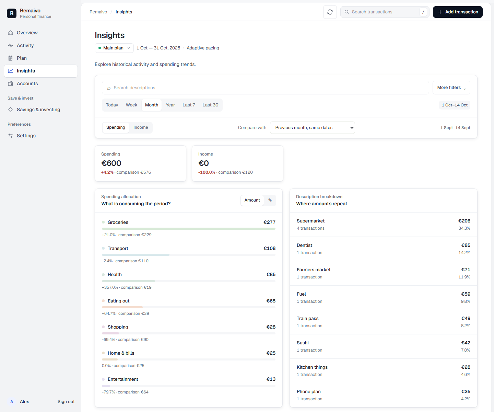
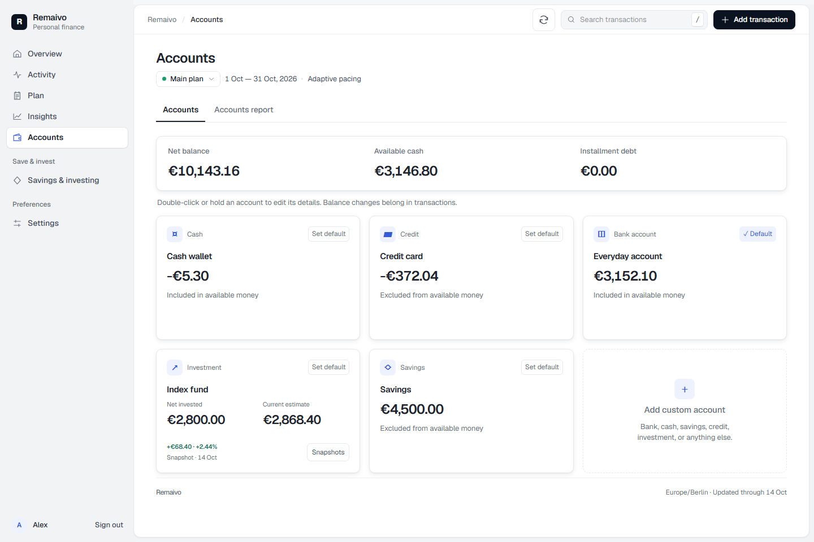
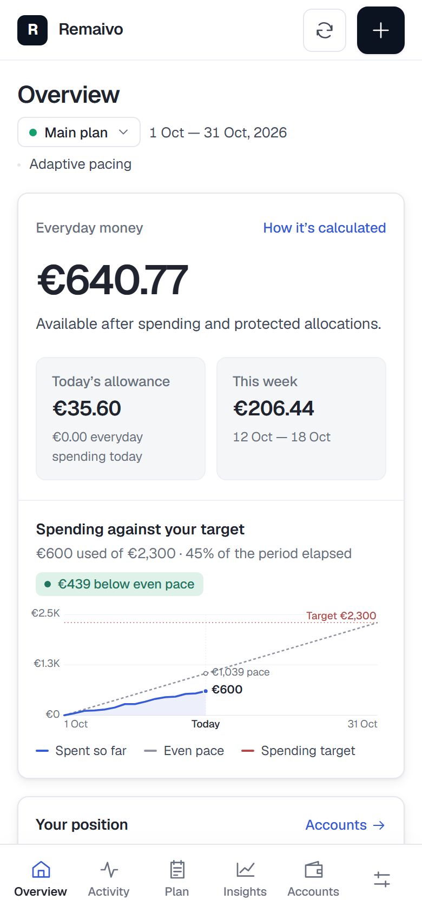

# Remaivo

**Know what's left.** Remaivo is a private personal finance app you run yourself: your accounts, everyday spending, bills and savings in one place, with a plan that tells you what you can still spend today.



## What it does

- **Accounts:** bank, savings, cash, credit cards and investments, starting from today's real balances.
- **Activity:** record income, spending and transfers; search and filter everything.
- **A spending plan (optional):** a monthly, payday or weekly target. Remaivo paces it into a daily and weekly allowance, protects money in buckets (like *Food*), and holds money aside for upcoming bills.
- **Scheduled payments:** rent, subscriptions, salary, one-off bills and pay-later installments, with reminders and one-tap recording.
- **Insights:** where your money goes, trends and comparisons with earlier periods.
- **Accounts report:** how each account and your net worth changed over a month or year.
- **Savings goals and investments,** including market-value snapshots.
- **Track only mode** if you just want to record money in and out without a plan.
- English and Greek, light and dark themes, works on phones and can be installed to the home screen.

| Plan | Insights |
| --- | --- |
|  |  |

| Accounts | On a phone |
| --- | --- |
|  |  |

## Get your own Remaivo

Each Remaivo belongs to one person (or a household sharing finances) and is protected by one password. Your data stays in your own account; nobody else can see it.

| | **Cloudflare** | **Docker** |
| --- | --- | --- |
| Cost | Free | Free at home, about $7/month on Render |
| Your computer needs to be on | No | At home: yes. On Render: no |
| Setup | One button, about 10 minutes | One button (Render) or one command (home) |
| Guide | **[Set up on Cloudflare](docs/setup-cloudflare.md)** | **[Set up with Docker](docs/setup-docker.md)** |

[](https://deploy.workers.cloudflare.com/?url=https://github.com/StvrvDimitris/remaivo)
[](https://render.com/deploy?repo=https://github.com/StvrvDimitris/remaivo)

Not sure? Pick **Cloudflare**: it's free, always on, and needs no computer of your own.

On your first visit you choose your password. Because a new server's address may already be public, that first visit also asks for a one-time setup code that only your server's logs show, so nobody else can claim it before you.

## For developers

Both deployment options run the same code: the app is a Cloudflare Worker (vinext, React, D1), and the Docker image runs it on workerd, Cloudflare's open-source runtime, with a local SQLite database.

Use Node.js 22.13 or later and pnpm. Copy `.dev.vars.example` to `.dev.vars` (optionally set a password), then:

```sh
pnpm install
pnpm dev
pnpm test
pnpm lint
pnpm build
```

The UI lives in `app/`; `app/api/finance/route.ts` handles authenticated finance requests. `worker/auth.ts` is the password sign-in and `worker/migrate.ts` brings the database up to date on startup. `db/setup.ts` creates the current Plan for new owners, `db/v3.ts` reconciles the Plan, buckets and scheduled payments, and `db/backup.ts` produces the JSON export.

`REMAIVO_HOST` picks the Worker config at build time: unset uses `wrangler.jsonc` (the Cloudflare template), `cloudflare` uses `wrangler.cloudflare.jsonc` (your own filled-in copy, which git ignores), and `selfhost` uses `wrangler.selfhost.jsonc` (the Docker image).

The schema is defined in `db/schema.ts` and `db/v3-schema.ts`. Every schema change needs a migration in `cloudflare/migrations/`, which every deployment applies, plus the matching `pnpm db:generate` migration in `drizzle/`, which the tests use. Keep already applied migration files unchanged.

Technical references: [cloudflare/README.md](cloudflare/README.md) and [selfhost/README.md](selfhost/README.md). Changes are listed in [CHANGELOG.md](CHANGELOG.md).

## License

[MIT](LICENSE)
