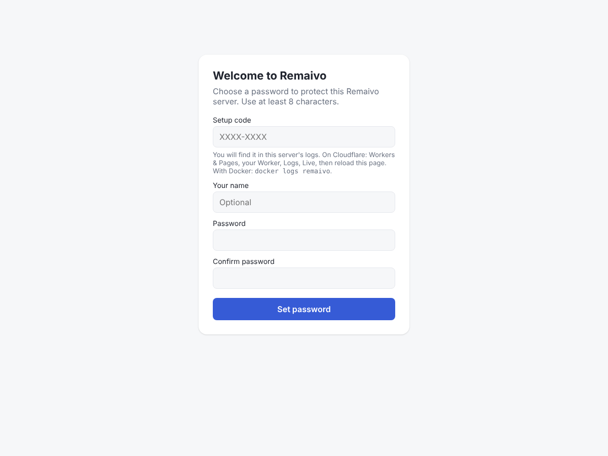
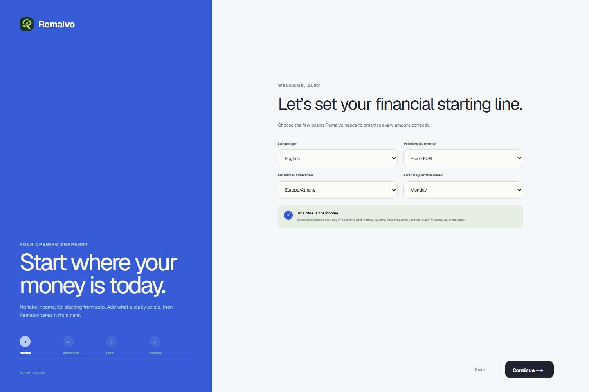

# Set up Remaivo with Docker

This guide is for anyone, no technical knowledge needed. Pick one of two ways:

- **A. On Render**: Remaivo runs in the cloud and you don't need your own computer to stay on. Costs about $7 a month.
- **B. On your own computer or home server**: free, but the computer has to be on when you want to use Remaivo.

Prefer free and always on, without Docker? Use [Cloudflare](setup-cloudflare.md) instead.

---

## A. On Render (about $7/month)

**You need:** a free **GitHub** account (<https://github.com/signup>) and a **Render** account (<https://dashboard.render.com/register>) with a payment card.

1. Click:

   [](https://render.com/deploy?repo=https://github.com/StvrvDimitris/remaivo)

2. Render shows what it will create: one web service called **remaivo** with a small disk for your data.
3. It asks for two values:
   - **REMAIVO_PASSWORD**: the password you'll sign in with (at least 8 characters).
   - **REMAIVO_NAME**: your name (optional).
4. Press **Apply** / **Deploy Blueprint** and wait. Render builds Remaivo from this repository, which takes about 5 to 10 minutes the first time.
5. Open the address Render shows (it ends in `.onrender.com`), sign in with your password, and follow the short setup ([see step 4 below](#4-tell-remaivo-where-your-money-is-today)).

**Change your password later:** in Render open the **remaivo** service → **Environment** → change `REMAIVO_PASSWORD` → **Save**. Render restarts Remaivo with the new password.

**Get updates:** in Render open the service → **Manual Deploy** → **Deploy latest commit**.

---

## B. On your own computer or home server (free)

### 1. Install Docker

- **Windows or Mac:** install **Docker Desktop** from <https://www.docker.com/products/docker-desktop/> and start it. Wait until it says it's running.
- **Linux, a NAS or a Raspberry Pi:** install Docker the usual way for your system. Synology, Unraid, CasaOS and similar have it built in.

### 2. Start Remaivo

Open a terminal: on Windows press Start and type **PowerShell**; on Mac open **Terminal**. Paste these two lines and press Enter:

```sh
docker build -t remaivo https://github.com/StvrvDimitris/remaivo.git#main
docker run -d --name remaivo -p 5007:5007 -v remaivo-data:/data --restart unless-stopped remaivo
```

The first line downloads Remaivo from GitHub and builds it on your computer. That takes a few minutes (longer on a Raspberry Pi), and only happens when you install or update. The second line starts it. Your data is kept in a storage area called `remaivo-data`, so it survives restarts and updates.

### 3. Open Remaivo and choose your password

Open <http://localhost:5007> in your browser. You'll see **Welcome to Remaivo**:



The **setup code** proves it's you choosing the password. To see it, run this in the terminal:

```sh
docker logs remaivo
```

Or in Docker Desktop: **Containers → remaivo → Logs**. Look for the line `Remaivo setup code: ABCD-EFGH`. Type that code, your name (optional) and a password (at least 8 characters, twice), then press **Set password**.

### 4. Tell Remaivo where your money is today



1. **Basics:** language, currency, timezone, first day of the week.
2. **Accounts:** where your money is right now, with today's balances. For credit cards, enter what you owe.
3. **Plan:** **Track and plan** for a spending target with daily guidance, or **Track only** to just record money in and out. You can change this later in Settings.
4. **Review**, then **Open Remaivo**.

### Use it from your phone at home

Your phone needs to be on the same Wi-Fi. Find your computer's local address (on Windows run `ipconfig` and look for *IPv4 Address*, for example `192.168.1.20`), then open `http://192.168.1.20:5007` on your phone.

To reach it from anywhere, the easiest safe way is [Tailscale](https://tailscale.com/) (free for personal use): install it on the computer and your phone, then use the computer's Tailscale address. Avoid opening ports on your router.

### Everyday questions

**I forgot my password.** Run this, then open Remaivo and choose a new password with the fresh setup code from `docker logs remaivo`. Your finance data is untouched.

```sh
docker exec remaivo node selfhost/server.mjs reset-password
```

**How do I back up my data?** In Remaivo open **Settings → Export** for a file with all your records. Your full database lives in the `remaivo-data` Docker volume.

**How do I get updates?** Run these three lines. Your data stays, and Remaivo updates its database by itself.

```sh
docker build -t remaivo https://github.com/StvrvDimitris/remaivo.git#main
docker rm -f remaivo
docker run -d --name remaivo -p 5007:5007 -v remaivo-data:/data --restart unless-stopped remaivo
```

**Can someone else use my Remaivo?** Yes. Share your Remaivo's address and password with up to four people you trust. After signing in, each person taps **Add a profile** on the *Who's using Remaivo?* page, picks a name, colour and icon, and sets up their own accounts and plan. Profiles keep everyone's money separate, but anyone with the password can open any profile, so share it only with people you trust. Switch profiles from **Settings → Switch or add a profile**.

**Will it start again after I restart my computer?** Yes, as long as Docker starts too (Docker Desktop has a *Start when you sign in* setting).

### Something went wrong?

- **The page doesn't open:** check Docker is running and the container shows as running (`docker ps`).
- **"port is already allocated":** something else uses port 5007. Use another, for example `-p 5010:5007`, then open <http://localhost:5010>.
- Still stuck? [Open an issue](https://github.com/StvrvDimitris/remaivo/issues) and describe what you see.

More technical details, settings and Docker Compose: [selfhost/README.md](../selfhost/README.md).
